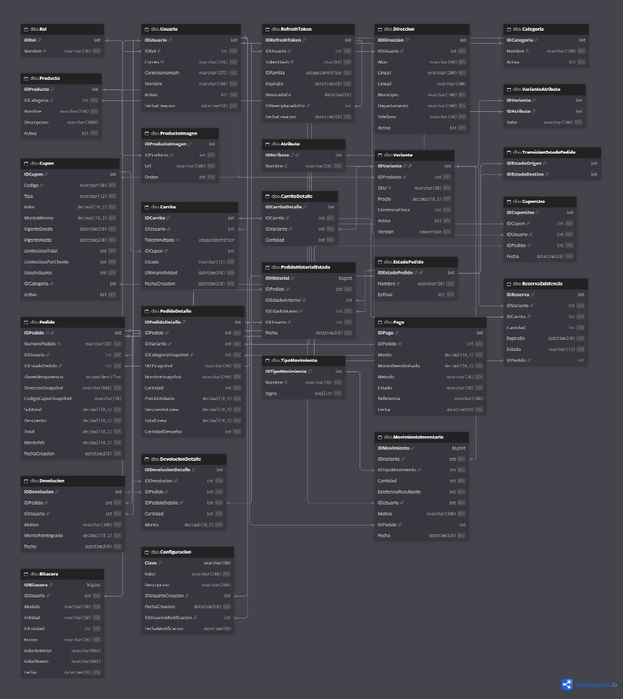
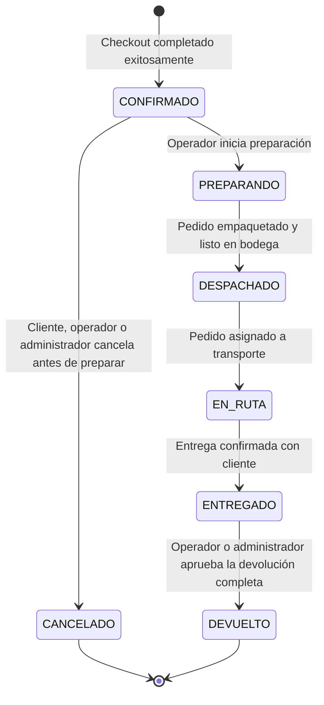

# ShopCart

ShopCart contiene una API REST empresarial desarrollada con Node.js 24 LTS, Express y TypeScript, y una base de datos relacional en Microsoft SQL Server. Implementa de forma integral autenticación, gestión de usuarios, catálogo con variantes e imágenes, kardex de inventario, carrito de compras (visitantes y registrados), cupones y promociones, checkout transaccional con reserva temporal e idempotencia, ciclo de vida de pedidos y devoluciones, reportes y métricas analíticas, configuración global y bitácora inmutable de auditoría. Todo el acceso a datos se realiza mediante Stored Procedures; no se utiliza ORM.

Esta es la guía general única para instalar el proyecto, preparar la base de datos, configurar el backend, probar el inicio de sesión y conocer las tecnologías utilizadas y las decisiones de diseño.

> [!TIP]
> **Guías detalladas por carpeta:**
> Para facilitar la navegación y configuración modular, cada carpeta principal del proyecto cuenta con su propia documentación especializada:
> - 📁 **Base de Datos:** [`database/README.md`](./database/README.md) — Explicación detallada del orden de ejecución de los 25 scripts DDL, catálogo completo de Stored Procedures (100 al 114), triggers de integridad, migraciones y códigos de error SQL 50xxx/51xxx.
> - 📁 **Backend API:** [`backend/README.md`](./backend/README.md) — Arquitectura en capas de Node.js + Express, variables de entorno, seguridad, encabezados especiales (`X-Guest-Cart-Token`, `X-Idempotency-Key`), envelopes y matriz de roles.
> - 🧪 **Pruebas de la API:** [`backend/PRUEBAS_API.md`](./backend/PRUEBAS_API.md) — Guía paso a paso con las 58 rutas y ejemplos JSON listos para importar o ejecutar en Postman para validar los requerimientos de RF-01 a RF-09.

---

## Requisitos

- Windows, PowerShell y Git.
- Node.js 24 LTS o superior y npm.
- SQL Server 2019 o superior (SQL Server Express fue suficiente para desarrollo local).
- SQL Server Management Studio (SSMS) u otra herramienta que ejecute scripts T-SQL (como Azure Data Studio).
- Un inicio de sesión de SQL Server con permisos para crear la base y objetos, y para que el backend ejecute los Stored Procedures.

La instancia debe aceptar conexiones TCP. Ten a mano su dirección, puerto, usuario SQL y contraseña.

---

## Si usas una instancia con nombre de SQL Server Express, configura TCP/IP y determina el puerto TCP que le corresponde esto se usara el SQL_SERVER_PORT.

En instancias con nombre de SQL Server Express (como `localhost\SQLEXPRESS`), el protocolo TCP/IP suele estar deshabilitado por defecto o utilizar puertos dinámicos. Para habilitarlo:
1. Abre **SQL Server Configuration Manager**.
2. Despliega **SQL Server Network Configuration** → **Protocols for SQLEXPRESS**.
3. Haz clic derecho en **TCP/IP** y selecciona **Enable**.
4. En las propiedades de TCP/IP, pestaña **IP Addresses**, desplázate hasta **IPAll**:
   - Borra el valor de *TCP Dynamic Ports* (si tiene alguno).
   - En *TCP Port*, asigna un puerto fijo (por ejemplo `1433`).
5. Reinicia el servicio de SQL Server desde *SQL Server Services*. Ese puerto es el que configurarás en la variable `SQL_PORT` (o `SQL_SERVER_PORT`) del backend.

---

## Instalación paso a paso

### 1. Clonar el repositorio

Abre PowerShell en la carpeta donde quieres guardar el proyecto:

```powershell
git clone https://github.com/eliaspozuelos/ShopCart.git
Set-Location .\ShopCart
```

Si ya tienes el repositorio clonado, abre PowerShell directamente en su carpeta.

### 2. Instalar las dependencias del backend

Desde la raíz del repositorio:

```powershell
Set-Location .\backend
npm install
if (-not (Test-Path .env)) { Copy-Item .env.example .env }
```

`npm install` instala las dependencias declaradas por el backend. Conserva la terminal en `backend/` para los pasos siguientes.

### 3. Crear la base de datos en SQL Server

Realiza estos pasos en orden. El método recomendado usa `001_CrearBaseDatos.sql`, que crea la base `ShopCart` y todas sus tablas. Ejecútalo en SQL Server.

**No ejecutes además los scripts modulares `0001` y `002`–`008`**, porque intentarían crear objetos que ya existen.

En SSMS:

1. Conéctate a la instancia de SQL Server que usará la API.
2. Abre y ejecuta `database/001_CrearBaseDatos.sql`. Este script crea la base `ShopCart` y todas las tablas.
3. Abre y ejecuta, en este orden, los Stored Procedures:
   - `database/100_SP_Auth.sql`
   - `database/101_SP_Usuarios.sql`
   - `database/102_SP_Usuarios_Perfil.sql`
   - `database/103_SP_Direcciones.sql`
   - `database/104_SP_Auth_Contrasena.sql`
   - `database/105_SP_Configuracion.sql`
   - `database/106_SP_Inventario.sql`
   - `database/107_SP_Catalogo.sql`
   - `database/108_SP_Cupones.sql`
   - `database/109_SP_Carrito.sql`
   - `database/110_SP_Bitacora.sql`
   - `database/111_SP_Pedidos_Checkout.sql`
   - `database/112_SP_Devoluciones.sql`
   - `database/113_SP_Reportes.sql`
   - `database/114_SP_Pedidos_Estado.sql`
4. Ejecuta los scripts de semillas:
   - `database/010_Semillas.sql`: Inserta los roles Cliente, Operador y Administrador, crea la cuenta Administrador inicial de demostración, inserta categorías/atributos y tipos de movimiento de inventario.
   - `database/011_Semillas_Pedidos.sql`: Inserta los estados del pedido (`CONFIRMADO`, `PREPARANDO`, `DESPACHADO`, `EN_RUTA`, `ENTREGADO`, `CANCELADO`, `DEVUELTO`) y las transiciones permitidas.
5. Ejecuta las migraciones y triggers de integridad:
   - `database/migrations/115_Migrar_Pago_Pendiente.sql`
   - `database/migrations/116_Migrar_Reservas_Idempotencia.sql`
   - `database/migrations/121_Migrar_Cancelacion_y_Reportes.sql`
   - `database/triggers/TR_Pedido_ValidarTransicionEstado.sql`
   - `database/triggers/TR_Bitacora_Inmutable.sql`

Los scripts `100`–`114` requieren que ya existan las tablas. La semilla se ejecuta después porque utiliza `SP_Usuarios_CrearAdministradorInicial`, definido en `101_SP_Usuarios.sql`.

### 4. Configurar el backend

Edita `backend/.env`, creado a partir de `.env.example`. Sustituye el usuario y contraseña SQL por los de tu instancia. Genera un secreto JWT en PowerShell; copia la salida en `JWT_ACCESS_SECRET`:

```powershell
$bytes = New-Object byte[] 32; $rng = [System.Security.Cryptography.RandomNumberGenerator]::Create(); try { $rng.GetBytes($bytes); [Convert]::ToBase64String($bytes) } finally { $rng.Dispose() }
```

La salida es una clave aleatoria de 32 bytes (44 caracteres Base64). Configura las variables principales:

```env
NODE_ENV=development
PORT=3000
CORS_ORIGINS=http://localhost:5173
SQL_SERVER=localhost
SQL_PORT=1433
SQL_DATABASE=ShopCart
SQL_USER=tu-usuario-sql
SQL_PASSWORD=tu-contraseña-sql
SQL_ENCRYPT=true
SQL_TRUST_SERVER_CERTIFICATE=true
JWT_ACCESS_SECRET=<pega-aqui-el-secreto-generado>
JWT_ACCESS_TTL_SECONDS=900
REFRESH_TOKEN_TTL_DAYS=7
COOKIE_SECURE=false
COOKIE_SAME_SITE=lax
```

Los valores de SQL Server deben corresponder a tu instalación.

Los valores `COOKIE_SECURE=false` y `COOKIE_SAME_SITE=lax` son para desarrollo local por HTTP.

### 5. Comprobar la conexión e iniciar la API

Desde PowerShell, si todavía estás en `backend/`, ejecuta:

```powershell
npm run db:check
```

Si estás en la raíz, primero ejecuta `cd backend`. `npm run db:check` debe finalizar sin errores de conexión. Solo después de que pase, inicia el servidor:

```powershell
npm run dev
```

El servidor de desarrollo queda activo en `http://localhost:3000`; comprueba `http://localhost:3000/health` y confirma que responde con estado `ok`. Déjalo ejecutándose mientras pruebas la API. Para detenerlo, pulsa `Ctrl+C`.

Para comprobar los tipos y compilar la versión de producción, desde `backend/` ejecuta:

```powershell
npm run typecheck
npm run build
npm start
```

Ejecuta `npm run build` antes de `npm start`; el servidor compilado se genera en `dist/`.

### 6. Probar inicio de sesión y registro

La semilla crea una cuenta de demostración **solo para desarrollo y pruebas locales**:

- **Correo:** `admin@example.com`
- **Contraseña:** `ShopCartDemo2026!`
- **Rol:** Administrador

La cuenta se crea únicamente si aún no existe un usuario Administrador.

---

### 7. Iniciar el frontend

Con la API en ejecución, abre otra terminal en la raíz del repositorio:

```powershell
Set-Location .\frontend
npm install
npm run dev
```

La tienda queda en `http://localhost:5173`. Vite reenvía `/api` hacia `http://localhost:3000`, de modo que el navegador conserva la cookie HttpOnly de la sesión. La guía del cliente está en [frontend/README.md](./frontend/README.md).

---

## Pruebas a través de Postman

Para registrar un Cliente, envía `POST http://localhost:3000/api/v1/auth/register` con este cuerpo JSON:

```json
{
  "email": "cliente@example.com",
  "password": "<elige-una-contraseña-de-al-menos-8-caracteres>",
  "name": "Cliente de prueba"
}
```

Para iniciar sesión, envía `POST http://localhost:3000/api/v1/auth/login`. Usa el correo y contraseña de la cuenta Administrador demo o del Cliente registrado:

```json
{
  "email": "admin@example.com",
  "password": "ShopCartDemo2026!"
}
```

Para rutas protegidas, envía el access token de la respuesta como token Bearer. Conserva la cookie HttpOnly que devuelve el login para probar `POST /api/v1/auth/refresh` y `POST /api/v1/auth/logout`.

Para la guía exhaustiva con las 58 rutas disponibles (catálogo, carrito, cupones, checkout, estados, devoluciones, dashboard y auditoría), consulta **[backend/PRUEBAS_API.md](./backend/PRUEBAS_API.md)**.

---

## Decisiones técnicas

- **Node.js, Express y TypeScript** para construir una API modular con tipado estático estricto.
- **SQL Server y Stored Procedures** para centralizar el acceso relacional y ejecutar operaciones con parámetros tipados; no se usa ORM ni concatenación dinámica para blindar contra inyecciones SQL.
- **Zod y bcrypt** para validar entradas/configuración y proteger las contraseñas con hashes seguros (costo de salteo 10-12).
- **JWT y refresh tokens rotatorios** para sesiones; el refresh token se transporta en cookie `HttpOnly` y se persiste en la base solo como hash SHA-256 con revocación automática de la familia de tokens ante sospecha de reutilización.
- **Moneda e Impuestos (Guatemala):** Todos los cálculos monetarios se realizan en **Quetzales (`GTQ`)** con precisión `DECIMAL(18,2)`. Los precios al público incluyen el **12% de IVA**, el cual se congela desglosado contablemente en cada orden según la fórmula legal: $\text{MontoIVA} = \text{Total} - (\text{Total} / 1.12)$.
- **Concurrencia en Inventario y Carrito:** Las reservas de stock expiran a los 15 minutos. El checkout evalúa existencias bajo bloqueo transaccional (`UPDLOCK, HOLDLOCK`) para impedir sobreventas.
- **Idempotencia en Checkout:** Soporte obligatorio del encabezado `X-Idempotency-Key` (UUID). Reintentos de red con la misma llave devuelven la orden original sin generar cobros duplicados.
- **Cancelación del pedido:** El Cliente, el Operador o el Administrador pueden cancelar solo mientras el pedido está en `CONFIRMADO`, antes de que empiece la preparación. En `PREPARANDO` la única salida es `DESPACHADO`. La cancelación reintegra la existencia en el kardex como `ENTRADA` y libera el cupón. El Cliente usa `POST /orders/:orderId/cancel`; el personal usa `PATCH /orders/:orderId/status`.
- **Devolución:** Con el pedido `ENTREGADO`, el Cliente solicita la devolución, total o parcial. Esa solicitud no mueve inventario. El Operador o el Administrador la aprueba y entonces se reintegra el kardex como `DEVOLUCION`, se actualiza el reembolso y, si ya no queda ninguna unidad, el pedido pasa a `DEVUELTO`. Rechazarla no cambia la existencia. Las devoluciones registradas antes de esta regla quedan en estado `APROBADA`.
- **Extras de la sección 09:** `POST /auth/login` y `POST /auth/register` comparten un límite de 5 intentos por minuto por IP. El dashboard se conserva 60 segundos en memoria y se descarta al crear un pedido, cambiar su estado, aprobar una devolución o ajustar existencia. El administrador descarga ese mismo periodo en Excel desde el panel. El libro conserva las hojas anteriores y agrega gráficos de ventas por día, semana y mes, categorías, top de productos y estados, además de la venta de cada día por categoría.

Los detalles específicos de la API están en [backend/README.md](./backend/README.md); las decisiones del esquema SQL, en [database/README.md](./database/README.md).

---

## Matriz de Cumplimiento del Reto (RF-01 a RF-09)

| Requerimiento | Alcance | Procedimientos / Tablas Clave |
| :--- | :--- | :--- |
| **RF-01: Autenticación y Usuarios** | Roles `Cliente`, `Operador`, `Administrador`. Libreta de direcciones, sesiones rotativas y cambio de clave. | `100_SP_Auth.sql` a `104_SP_Auth_Contrasena.sql`. |
| **RF-02: Catálogo de Productos** | Categorías, atributos (alta, cambio de nombre y baja si ninguna variante los usa), variantes con foto y estado, imagen de producto como respaldo, búsqueda con filtros y paginación. Carga atómica JSON. | `107_SP_Catalogo.sql`, `115_Variante_UrlImagen.sql`, `dbo.Producto`, `dbo.Variante`, `dbo.Atributo`. |
| **RF-03: Inventario y Kardex** | Stock físico, stock reservado y disponible neto. Ajustes con motivo obligatorio y trazabilidad completa. | `106_SP_Inventario.sql`, `dbo.MovimientoInventario`. |
| **RF-04: Carrito de Compras** | Carritos para visitantes anónimos (`X-Guest-Cart-Token`) y clientes autenticados. Fusión automática al login. | `109_SP_Carrito.sql`, `dbo.Carrito`, `dbo.ReservaExistencia`. |
| **RF-05: Cupones y Promociones** | Descuentos porcentuales o monto fijo. Validación de compra mínima, vigencia, límite global y por cliente. | `108_SP_Cupones.sql`, `dbo.Cupon`. |
| **RF-06: Checkout y Pago** | Conversión atómica del carrito, validación de stock, registro de venta en kardex y pagos `TARJETA` / `CONTRA_ENTREGA`. | `111_SP_Pedidos_Checkout.sql`, `dbo.Pago`. |
| **RF-07: Gestión de Pedidos** | Máquina de estados: `CONFIRMADO` $\rightarrow$ `PREPARANDO` $\rightarrow$ `DESPACHADO` $\rightarrow$ `EN_RUTA` $\rightarrow$ `ENTREGADO`. La cancelación solo sale de `CONFIRMADO`, antes de preparar, y el stock vuelve al kardex. | `114_SP_Pedidos_Estado.sql`, `TR_Pedido_ValidarTransicionEstado`. |
| **RF-08: Devoluciones** | Solicitud sobre un pedido entregado. El inventario vuelve como `DEVOLUCION` cuando el operador o el administrador la aprueba. Puede ser parcial. | `112_SP_Devoluciones.sql`, `dbo.Devolucion`. |
| **RF-09: Reportes y Bitácora** | Métricas de ventas netas descontando devoluciones, top 10 productos y log inmutable de auditoría con trigger. | `113_SP_Reportes.sql`, `110_SP_Bitacora.sql`, `TR_Bitacora_Inmutable`. |

---

## Modelo de Datos y Estado Funcional

El esquema relaciona roles con usuarios; usuarios con sesiones (refresh tokens), direcciones, carritos y pedidos; productos con categorías, variantes e inventario; pedidos con detalles, pagos, estados e historial; y devoluciones con pedidos y sus detalles. También incluye cupones y bitácora de auditoría inmutable.

### Diagrama Entidad-Relación (ERD)



*Diagrama relacional oficial generado en dbdiagram.io modelando las 26 tablas del sistema, llaves primarias, foráneas, tipos de datos e índices.*

### Ciclo de Vida del Pedido (Máquina de Estados)

El flujo de pedidos implementado en la base de datos y en la API es:



La cancelación solo existe desde `CONFIRMADO`, antes de que el pedido entre a preparación. El Cliente cancela el suyo con `POST /orders/:orderId/cancel`. El Operador o el Administrador también pueden hacerlo con `PATCH /orders/:orderId/status`. En `PREPARANDO` ya no se cancela: el pedido sigue a `DESPACHADO`. Al cancelar, el procedimiento reintegra la existencia pendiente en el kardex como `ENTRADA` y devuelve el uso del cupón.

La devolución no mueve inventario al solicitarla. Con el pedido en `ENTREGADO`, el Cliente envía `POST /orders/:orderId/returns` y queda una solicitud `SOLICITADA`. El Operador o el Administrador la aprueba o la rechaza con `PATCH /orders/:orderId/returns/:returnId`. Solo la aprobación reintegra el kardex como `DEVOLUCION`, actualiza el reembolso y, cuando todas las unidades fueron devueltas, pasa el pedido a `DEVUELTO`. Una devolución parcial deja el pedido en `ENTREGADO`. Las solicitudes que ya se habían registrado antes de esta regla quedan `APROBADA`, porque el inventario ya se había movido.

---

## 📁 Estructura del Repositorio y Documentación

Cada módulo cuenta con su propio README explicativo para guiar la instalación y desarrollo independiente:

```text
ShopCart/
├── README.md                           # Guía general, instalación, ERD, máquina de estados y decisiones
├── database/                           # Scripts T-SQL y procedimientos almacenados (SQL Server)
│   ├── README.md                       # Documentación técnica detallada de la BD, DDL, SPs y errores 50xxx
│   ├── 001_CrearBaseDatos.sql          # Creación consolidada de base y tablas
│   ├── 010_Semillas.sql                # Semillas demo de roles, usuarios, catálogo e inventario
│   ├── 011_Semillas_Pedidos.sql        # Catálogo de estados y transiciones de pedidos
│   ├── 100_SP_Auth.sql ... 114_SP_*.sql# Procedimientos almacenados de los 9 requerimientos
│   ├── migrations/                     # Scripts de migración idempotentes
│   ├── tablas/                         # Scripts DDL modulares (0001 a 009)
│   └── triggers/                       # Triggers de máquina de estados e inmutabilidad de bitácora
├── frontend/                           # Tienda React 19 + TypeScript (Vite)
│   ├── README.md                       # Cómo ejecutar el cliente y qué módulos cubre
│   └── src/                            # Módulos auth, catálogo, carrito, checkout, pedidos y cuenta
├── backend/                            # API REST (Node.js 24 + Express + TypeScript)
│   ├── README.md                       # Documentación técnica del backend, capas, .env y seguridad
│   ├── PRUEBAS_API.md                  # Colección completa de pruebas con Postman para RF-01 a RF-09
│   ├── package.json                    # Scripts npm (dev, build, start, typecheck, db:check)
│   ├── tsconfig.json                   # Configuración estricta de TypeScript
│   └── src/                            # Código fuente modular en capas (routes, controllers, services, repositories)
└── docs/
    └── img/
        └── erd_diagram.png             # Diagrama Entidad-Relación oficial en alta resolución
```
