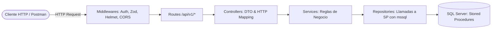

# Backend de ShopCart API

API REST empresarial para la plataforma de comercio electrónico ShopCart, construida con **Node.js 24 LTS**, **Express 5** y **TypeScript**. La arquitectura de persistencia se basa **estrictamente en Stored Procedures sobre Microsoft SQL Server** mediante la librería `mssql`, prescindiendo completamente de ORMs para garantizar el control transaccional fino, la integridad de los datos y el rendimiento.

---

## 1. Requisitos del Entorno

- **Node.js:** Versión 24 LTS o superior.
- **Gestor de paquetes:** `npm` v10+.
- **Motor de Base de Datos:** Microsoft SQL Server 2019 o superior (SQL Server Express local es suficiente para desarrollo).
- **Conectividad TCP/IP:** La instancia de SQL Server debe tener el protocolo TCP/IP habilitado.
- **Esquema y Procedimientos Almacenados:** Todos los scripts de `database/` ejecutados exitosamente en orden (consultar [database/README.md](../database/README.md)).

> [!IMPORTANT]
> **Si usas una instancia con nombre de SQL Server Express:**
> Configura el protocolo **TCP/IP** en *SQL Server Configuration Manager* (*SQL Server Network Configuration* → *Protocols for SQLEXPRESS*), actívalo y determina el puerto TCP dinámico o fijo asignado (habitualmente `1433`). Dicho puerto debe asignarse a la variable `SQL_PORT` en el archivo `.env`. Ten a mano tu usuario SQL (`sa` u otro con permisos) y contraseña.

---

## 2. Instalación y Configuración

Desde una terminal PowerShell en la raíz del proyecto o en la carpeta `backend`:

```powershell
# 1. Posicionarse en la carpeta backend
cd backend

# 2. Instalar dependencias
npm install

# 3. Crear el archivo de variables de entorno
if (-not (Test-Path .env)) { Copy-Item .env.example .env }
```

### Configuración del archivo `.env`

Genera un secreto criptográfico aleatorio seguro de 32 bytes (Base64) para `JWT_ACCESS_SECRET` con este comando de PowerShell:

```powershell
$bytes = New-Object byte[] 32; $rng = [System.Security.Cryptography.RandomNumberGenerator]::Create(); try { $rng.GetBytes($bytes); [Convert]::ToBase64String($bytes) } finally { $rng.Dispose() }
```

Configura tu archivo `backend/.env` con los parámetros de conexión correspondientes:

```env
# Servidor y Entorno
PORT=3000
NODE_ENV=development

# Conexión SQL Server (Instancia ShopCart)
SQL_SERVER=localhost
SQL_PORT=1433
SQL_DATABASE=ShopCart
SQL_USER=sa
SQL_PASSWORD=TuPasswordSeguro123!
SQL_ENCRYPT=false
SQL_TRUST_SERVER_CERTIFICATE=true

# Seguridad y Autenticación JWT
JWT_ACCESS_SECRET=pega_aqui_el_secreto_generado_en_base64
JWT_ACCESS_EXPIRES_IN=15m
JWT_REFRESH_EXPIRES_DAYS=7

# Clientes permitidos (CORS)
CORS_ORIGIN=http://localhost:5173
```

> [!WARNING]
> Nunca incluyas el archivo `.env` en el control de versiones (Git). Contiene secretos criptográficos y credenciales de acceso a la base de datos.

---

## 3. Scripts de Ejecución y Validación

El proyecto incluye scripts en `package.json` para ciclo de vida de desarrollo, tipado y producción:

| Script | Comando | Descripción |
| :--- | :--- | :--- |
| `db:check` | `npm run db:check` | Prueba de conectividad inmediata con la instancia de SQL Server. |
| `typecheck` | `npm run typecheck` | Validación de tipos estáticos con TypeScript en modo estricto (`tsc --noEmit`). |
| `dev` | `npm run dev` | Inicia el servidor de desarrollo en caliente usando `tsx watch` sobre `src/server.ts`. |
| `build` | `npm run build` | Compila el código TypeScript a JavaScript estándar en el directorio `dist/`. |
| `start` | `npm run start` | Arranca la aplicación compilada en modo producción (`node dist/server.js`). |

Comprobación de salud:
```http
GET http://localhost:3000/health
```
Respuesta esperada: `{"status":"ok","uptime":...}`

---

## 4. Arquitectura de Software

El backend sigue un patrón desacoplado en capas de responsabilidad única:



- **`src/middlewares/`:**
  - `authenticate.middleware.ts`: Valida el Bearer Access Token (`authenticate`), permite visitantes anónimos (`optionalAuthenticate`) y restringe por roles (`requireRole('Administrador', 'Operador')`).
  - `error.middleware.ts`: Capturador global de excepciones, transformador de errores Zod, errores de negocio (`AppError`) y errores SQL Server a un formato estándar.
- **`src/modules/`:** 12 módulos funcionales independientes conteniendo:
  - `*.routes.ts`: Definición de endpoints HTTP.
  - `*.controller.ts`: Extracción de parámetros, headers y serialización de respuestas.
  - `*.service.ts`: Orquestación de lógica de negocio, validaciones y cálculos.
  - `*.repository.ts`: Interfaz directa con SQL Server mediante `mssql.Request().execute('dbo.sp_...')`.
  - `*.schemas.ts`: Validaciones de esquemas en tiempo de ejecución con **Zod v4**.

---

## 5. Estándares de Comunicación API

### 5.1. Prefijo y Versión
Todas las rutas de la API de negocio están expuestas bajo el prefijo:
```
/api/v1
```

### 5.2. Encabezados Especiales (Headers)

| Header | Formato / Ejemplo | Uso |
| :--- | :--- | :--- |
| `Authorization` | `Bearer eyJhbGciOi...` | Envío del Access Token JWT emitido tras el login. |
| `X-Guest-Cart-Token` | `UUID v4` (ej: `d2b45a0b-...`) | Identificador de sesión para carritos de invitados. Permite mantener el carrito sin registrarse y fusionarlo automáticamente al iniciar sesión. |
| `X-Idempotency-Key` | `UUID v4` (ej: `c4a17e88-...`) | Llave de idempotencia para `POST /orders/checkout`. Previene órdenes duplicadas si la red reintenta la solicitud. |
| `Cookie` | `shopcart_refresh=...` | Cookie HttpOnly enviada automáticamente por el navegador/Postman para renovar (`/auth/refresh`) y cerrar sesión (`/auth/logout`). |

### 5.3. Estructura de Respuesta Exitosa (Envelope)
```json
{
  "data": { ... }
}
```

### 5.4. Estructura de Error Estandarizada
```json
{
  "error": {
    "code": "INSUFFICIENT_STOCK",
    "message": "No hay suficiente existencia disponible para la variante solicitada.",
    "details": []
  }
}
```

---

## 6. Catálogo Completo de Endpoints y Matriz de Roles

### Roles de Usuario:
- **Público:** Accesible anónimamente sin credenciales.
- **Cliente:** Usuarios registrados que compran en la tienda.
- **Operador:** Personal de bodega y logística (gestión de stock, kardex y despacho de órdenes).
- **Administrador:** Acceso total (catálogo, usuarios, cupones, configuración global, bitácora y reportes).

### 6.1. Módulo de Autenticación y Sesiones (`/auth`)
| Método | Endpoint | Rol Requerido | Descripción |
| :--- | :--- | :--- | :--- |
| `POST` | `/auth/register` | Público | Registro público de nuevos clientes. |
| `POST` | `/auth/login` | Público | Autenticación con email/password. Retorna JWT y establece cookie HttpOnly `shopcart_refresh`. |
| `POST` | `/auth/refresh` | Cookie HttpOnly | Rotación de Refresh Token y emisión de nuevo Access Token. |
| `POST` | `/auth/logout` | Cookie HttpOnly | Invalida el Refresh Token en BD y elimina la cookie de sesión. |
| `PATCH` | `/auth/password` | Cliente, Operador, Admin | Cambio de contraseña propia (requiere contraseña actual). |

### 6.2. Módulo de Usuarios y Direcciones (`/users`)
| Método | Endpoint | Rol Requerido | Descripción |
| :--- | :--- | :--- | :--- |
| `GET` | `/users/me` | Cliente, Operador, Admin | Consulta del perfil autenticado. |
| `PATCH` | `/users/me` | Cliente, Operador, Admin | Actualización de nombre o email del usuario autenticado. |
| `POST` | `/users/me/addresses` | Cliente, Operador, Admin | Agrega una dirección de entrega al perfil propio. |
| `PUT` | `/users/me/addresses/:addressId` | Cliente, Operador, Admin | Actualiza una dirección existente propia. |
| `GET` | `/users` | Administrador | Listado paginado de usuarios con filtros por rol, estado y búsqueda. |
| `POST` | `/users` | Administrador | Creación interna de usuarios con rol Operador o Administrador. |
| `GET` | `/users/:userId` | Administrador | Detalle completo de un usuario específico. |
| `PATCH` | `/users/:userId` | Administrador | Actualización administrativa de datos de un usuario. |
| `PATCH` | `/users/:userId/status` | Administrador | Activa o desactiva la cuenta de un usuario. |

### 6.3. Módulo de Catálogo de Productos (`/catalog`)
| Método | Endpoint | Rol Requerido | Descripción |
| :--- | :--- | :--- | :--- |
| `GET` | `/catalog/categories` | Público | Lista de categorías de productos activas. |
| `GET` | `/catalog/attributes` | Público | Lista de tipos de atributos para variantes (Talla, Color, etc.). |
| `GET` | `/catalog/products` | Público | Búsqueda y listado paginado con filtros por categoría, precio, disponibilidad y orden. |
| `GET` | `/catalog/products/:productId` | Público | Detalle de un producto con sus imágenes y variantes activas con stock. |
| `GET` | `/catalog/admin/categories` | Administrador | Lista todas las categorías (incluidas inactivas). |
| `POST` | `/catalog/admin/categories` | Administrador | Crea una nueva categoría. |
| `PATCH` | `/catalog/admin/categories/:categoryId` | Administrador | Modifica el nombre o estado activo de una categoría. |
| `POST` | `/catalog/admin/attributes` | Administrador | Registra un nuevo tipo de atributo. |
| `GET` | `/catalog/admin/products` | Administrador | Lista administrativa de productos (activos e inactivos). |
| `GET` | `/catalog/admin/products/:productId` | Administrador | Detalle administrativo con variantes e imágenes completas. |
| `POST` | `/catalog/admin/products` | Administrador | Creación atómica de producto, variantes, imágenes y stock inicial en kardex. |
| `PATCH` | `/catalog/admin/products/:productId` | Administrador | Actualiza nombre, descripción o estado de un producto. |
| `POST` | `/catalog/admin/products/:productId/variants` | Administrador | Agrega una variante al producto con stock inicial. |
| `PUT` | `/catalog/admin/products/:productId/variants/:variantId` | Administrador | Modifica SKU, precio, atributos y existencia física absoluta. |
| `PATCH` | `/catalog/admin/products/:productId/variants/:variantId/status` | Administrador | Activa o desactiva una variante. |
| `POST` | `/catalog/admin/products/:productId/images` | Administrador | Agrega una imagen con URL y orden. |
| `PUT` | `/catalog/admin/products/:productId/images/:imageId` | Administrador | Actualiza URL y orden de una imagen. |
| `DELETE` | `/catalog/admin/products/:productId/images/:imageId` | Administrador | Elimina lógicamente una imagen de producto. |

### 6.4. Módulo de Inventario y Kardex (`/inventory`)
| Método | Endpoint | Rol Requerido | Descripción |
| :--- | :--- | :--- | :--- |
| `GET` | `/inventory/variants/:variantId/stock` | Operador, Admin | Consulta stock físico, reservado activo y disponibilidad neta. |
| `PATCH` | `/inventory/variants/:variantId/stock` | Operador, Admin | Ajuste manual de existencia con motivo obligatorio y registro en kardex. |
| `GET` | `/inventory/movements` | Operador, Admin | Consulta paginada del kardex con filtros por variante y fecha. |

### 6.5. Módulo de Cupones y Promociones (`/coupons`)
| Método | Endpoint | Rol Requerido | Descripción |
| :--- | :--- | :--- | :--- |
| `POST` | `/coupons/validate` | Público / Cliente | Valida vigencia, stock de usos, compra mínima y calcula descuento. |
| `GET` | `/coupons` | Administrador | Listado paginado de cupones con filtros de vigencia y estado. |
| `GET` | `/coupons/:couponId` | Administrador | Detalle de reglas de un cupón específico. |
| `POST` | `/coupons` | Administrador | Crea un cupón (porcentaje o monto fijo, límite total y por cliente). |
| `PATCH` | `/coupons/:couponId` | Administrador | Modifica vigencia, límites o desactiva un cupón. |

### 6.6. Módulo de Carrito de Compras (`/cart`)
| Método | Endpoint | Rol Requerido | Descripción |
| :--- | :--- | :--- | :--- |
| `GET` | `/cart` | Público / Cliente | Obtiene o inicializa el carrito (soporta token de invitado `X-Guest-Cart-Token`). |
| `DELETE` | `/cart` | Público / Cliente | Vacía todos los ítems y remueve el cupón del carrito. |
| `POST` | `/cart/items` | Público / Cliente | Agrega una variante al carrito verificando stock disponible y reservando 15 min. |
| `PATCH` | `/cart/items/:itemId` | Público / Cliente | Actualiza la cantidad de una línea del carrito. |
| `DELETE` | `/cart/items/:itemId` | Público / Cliente | Remueve una línea del carrito y libera su reserva de existencia. |
| `POST` | `/cart/coupon` | Público / Cliente | Aplica un cupón de descuento al carrito de compras. |
| `DELETE` | `/cart/coupon` | Público / Cliente | Quita el cupón aplicado al carrito. |

### 6.7. Módulo de Checkout y Pedidos (`/orders`)
| Método | Endpoint | Rol Requerido | Descripción |
| :--- | :--- | :--- | :--- |
| `POST` | `/orders/checkout` | Cliente | Convierte el carrito en pedido, descuenta stock del kardex y registra pago. |
| `GET` | `/orders` | Cliente, Operador, Admin | Cliente consulta sus pedidos; Operador y Admin consultan todos con filtros. |
| `GET` | `/orders/:orderId` | Cliente, Operador, Admin | Detalle con líneas, montos, desglose de impuestos e historial de estados. |
| `PATCH` | `/orders/:orderId/status` | Operador, Admin | Transición de estado (`PREPARANDO`, `DESPACHADO`, `EN_RUTA`, `ENTREGADO`, `CANCELADO`). |
| `POST` | `/orders/:orderId/returns` | Cliente, Operador, Admin | Registra devolución sobre orden entregada y reintegra stock al kardex. |

### 6.8. Módulo de Reportes de Inteligencia de Negocio (`/reports`)
| Método | Endpoint | Rol Requerido | Descripción |
| :--- | :--- | :--- | :--- |
| `GET` | `/reports/dashboard` | Administrador | Dashboard con ventas netas (restando devoluciones), series temporales, categorías y top 10 productos. |

### 6.9. Módulo de Configuración del Sistema (`/configuration`)
| Método | Endpoint | Rol Requerido | Descripción |
| :--- | :--- | :--- | :--- |
| `GET` | `/configuration` | Administrador | Lista de parámetros globales del sistema. |
| `POST` | `/configuration` | Administrador | Registra una nueva clave de configuración. |
| `PATCH` | `/configuration/:key` | Administrador | Modifica el valor de un parámetro existente. |

### 6.10. Módulo de Bitácora de Auditoría (`/audit`)
| Método | Endpoint | Rol Requerido | Descripción |
| :--- | :--- | :--- | :--- |
| `GET` | `/audit` | Administrador | Consulta paginada del log de auditoría inmutable de eventos críticos. |

---

## 7. Políticas de Seguridad e Integridad Implementadas

1. **Sin ORM:** Todas las escrituras y lecturas críticas invocan procedimientos almacenados compilados en SQL Server, evitando cualquier concatenación o inyección SQL.
2. **Idempotencia en Checkout:** El header `X-Idempotency-Key` garantiza que un reintento por problemas de red o doble clic no genere un pedido duplicado ni cobre dos veces.
3. **Manejo Seguro de Contraseñas:** Encriptación con `bcrypt` (10 rondas de salteo) para credenciales de acceso.
4. **Almacenamiento de Tokens:**
   - Access Token en memoria / header `Authorization`.
   - Refresh Token rotativo almacenado únicamente como **hash SHA-256** en la tabla `dbo.SesionUsuario` y transmitido mediante cookie `HttpOnly` con directivas `SameSite=Strict`.
5. **No Almacenamiento de Datos Financieros Sensibles:** El método `TARJETA` procesa y confirma la transacción de forma simulada/local sin guardar número de tarjeta, CVV o vencimiento.
6. **Manejo Monetario y Fiscal:** Todos los cálculos utilizan tipos `decimal(18,2)` en Quetzales (`GTQ`), desglosando el 12% de IVA en líneas y encabezados de pedidos sin discrepancias por redondeo.
