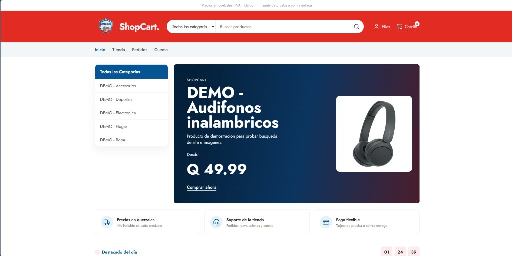
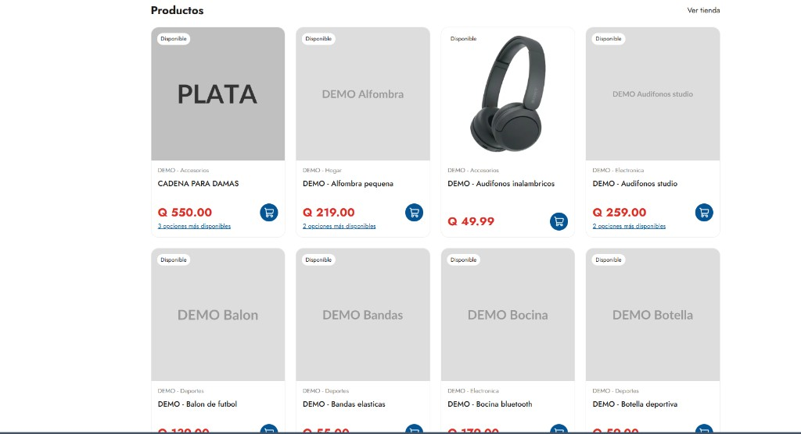
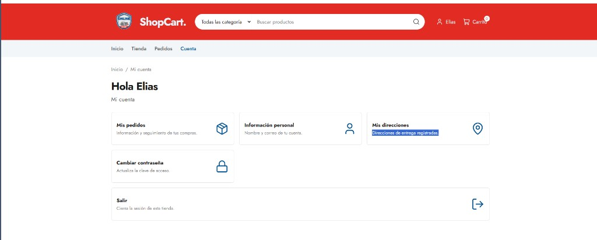
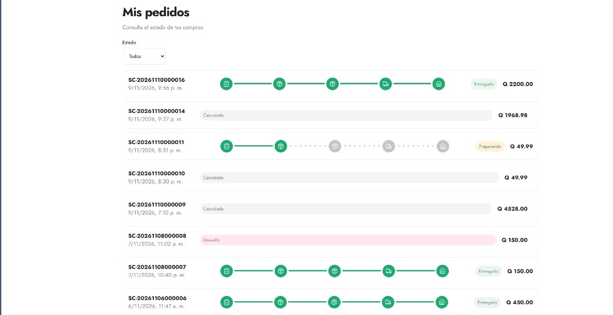
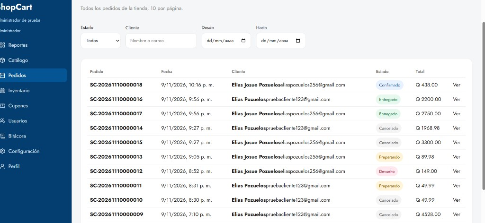
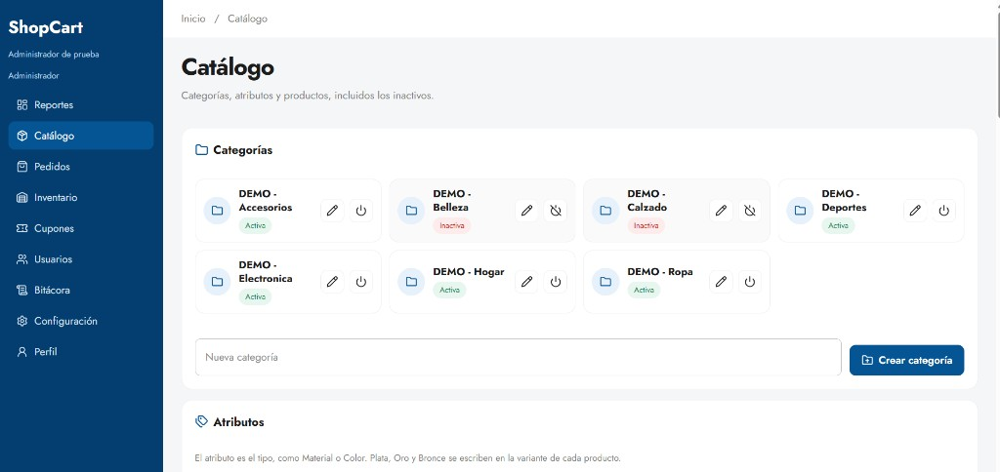

# Frontend de ShopCart

Tienda web en **React 19** y **TypeScript**, construida con Vite. Se organiza por módulos y consume la API en `/api/v1`. La tienda tiene barra superior, buscador con categorías, departamentos, inicio y grilla de productos.

## Pantallas

### Inicio



### Productos



### Cuenta



### Pedidos del cliente



### Pedidos del panel



### Catálogo del panel



## Módulos

```text
src/
├── app/            Composición: rutas, proveedores y layout
├── styles/         CSS global partido por sección (variables, base, layout, tienda, carrito, cuenta, admin)
├── shared/         Cliente HTTP, formato de dinero y componentes comunes
└── modules/
    ├── auth/       Registro, sesión y contraseña
    ├── catalog/    Categorías, búsqueda y detalle
    ├── cart/       Carrito de invitado y de cliente
    ├── checkout/   Pago con dirección e idempotencia
    ├── orders/     Pedidos, estados y devoluciones
    ├── account/    Perfil y direcciones
    └── admin/      Panel de reportes y administración
```

## Cómo ejecutarlo

La API debe estar activa en `http://localhost:3000`. En otra terminal:

```powershell
cd frontend
npm install
npm run dev
```

Abre `http://localhost:5173`. Vite reenvía `/api` al backend, así el navegador guarda la cookie HttpOnly `shopcart_refresh`.

Scripts:

| Script | Comando | Uso |
| :--- | :--- | :--- |
| Desarrollo | `npm run dev` | Tienda con recarga |
| Tipos | `npm run typecheck` | `tsc` en modo estricto |
| Producción | `npm run build` | Compila a `dist/` |
| Vista previa | `npm run preview` | Sirve la compilación |

Si el frontend no pasa por este proxy, define `VITE_API_URL` con el origen del backend. El ejemplo está en `.env.example`.

## Qué instalamos

El frontend no usa una librería de estilos, de estado ni de peticiones HTTP. Estas son las dependencias y para qué quedó cada una.

| Paquete | Para qué sirve |
| :--- | :--- |
| `react` y `react-dom` 19 | Dibujan la tienda y el panel. El estado de sesión, carrito, catálogo y avisos vive en contexto de React. |
| `react-router-dom` 7 | Define las rutas del navegador: tienda, cuenta, checkout y panel. También separa el ingreso de clientes del ingreso de personal. |
| `lucide-react` | Iconos de la interfaz (carrito, usuario, búsqueda, cantidad, basura, estados del pedido). Se importan por nombre, por ejemplo `ShoppingCart` o `Trash`, para que el origen quede explícito. |
| `echarts` | Gráficas del panel de reportes. Se monta en un `div` y solo se cargan líneas, barras y pastel. |
| `vite` y `@vitejs/plugin-react` | Servidor de desarrollo, recarga al guardar y compilación. El proxy de Vite reenvía `/api` al backend. |
| `typescript` | Revisa los tipos antes de compilar. `npm run typecheck` usa el modo estricto del proyecto. |
| `@types/react`, `@types/react-dom` y `@types/node` | Tipos de React, del DOM y de Node para el editor y para `tsc`. |
| `oxlint` | Revisión rápida del código con `npm run lint`. |

React no trae iconos ni un contador listos. Por eso la cantidad se armó con botones propios y los iconos salen de `lucide-react`, en lugar de dibujar cada SVG a mano.

## Decisiones técnicas

**Misma origen para la cookie de sesión.** El access token se guarda en memoria. La renovación viaja en la cookie HttpOnly `shopcart_refresh`. Vite publica la tienda en `http://localhost:5173` y reenvía `/api` a `http://localhost:3000`, así el navegador trata tienda y API como el mismo sitio y puede guardar esa cookie. `credentials: 'include'` va en cada `fetch`.

**Un cliente HTTP propio.** `src/shared/api/client.ts` usa `fetch`. Agrega `Authorization: Bearer` cuando hay sesión, manda `X-Guest-Cart-Token` en el carrito de visitante y, si el access token venció, lo renueva una vez y repite la petición.

**Dos ingresos, una sola sesión.** `/ingresar` es la tienda. `/empresa` es el personal y la tienda no enlaza esa ruta. Un cliente que entra por `/empresa` conserva la sesión y vuelve a la tienda. Operador y Administrador usan el panel en `/admin`. Quien no tiene sesión y abre `/admin` va a `/empresa`. La autorización la hace el rol: el backend responde 403 si el rol no alcanza.

**El pago no se salta el carrito.** En la ficha se elige la cantidad y el botón agrega esa cantidad. En la tarjeta, si el producto tiene una sola variante con existencia, el botón agrega una unidad; si hay más, abre la ficha. La cantidad y la eliminación también están en el cajón y en `/carrito`. **Pagar** en el cajón abre esa revisión. **Continuar al pago** entra a `/checkout`, y solo para el rol Cliente.

**Bitácora.** En `/admin/bitacora` hay tres gráficos con los totales de toda la bitácora: barras por módulo, barras por acción y una línea de los últimos 30 días. La tabla de abajo lista el detalle, 10 eventos por página. El filtro de módulo solo cambia esa tabla.

**Reportes con ECharts.** En `/admin`, ventas por día, categorías, productos y estados salen de los datos que ya devuelve la API. La librería es `echarts`, sin un envoltorio de React: el gráfico se crea al montar el panel y se destruye al salir. **Exportar a Excel** descarga el periodo elegido en `.xlsx`, con gráfico en las ventas por día, semana y mes, en categorías, en el top de productos y en los estados, más la hoja de ventas por día y categoría.

**Catálogo en páginas, inicio en vista previa.** `/tienda` pide 12 productos por página y muestra Anterior / Siguiente cuando hay más de una página. El inicio pide 8: es una muestra, no un segundo catálogo. El nombre de la tarjeta reserva dos líneas para que el precio quede a la misma altura en toda la fila. La tarjeta muestra el precio más bajo. Si hay más variantes, debajo aparece un enlace como «2 opciones más disponibles» que abre la ficha.

**Departamentos de la tienda.** En `/tienda`, Departamentos es una tarjeta al lado de la grilla. Se queda fija al bajar, marca la categoría actual y, si hay más de cinco, muestra **Ver más**. En pantallas de 1000 px o menos deja de ser fija y queda arriba de los productos.

**Fotos del producto.** En el listado, el inicio y el carrito se muestra la foto de la variante. `ProductoImagen` queda como respaldo cuando la variante no tiene la suya. En la ficha, la galería usa la foto de la variante elegida; si no tiene, usa las imágenes del producto. Si hay más de una, las demás quedan en una fila debajo y al elegir una cambia la principal. Al pasar el cursor se muestra un acercamiento.

**Departamento y municipio.** En la cuenta, el perfil del personal y el alta de usuarios, esos campos salen de la lista de Guatemala. Al elegir el departamento, el municipio solo muestra los de ese departamento.

**Usuarios del panel.** En `/admin/usuarios` la tabla muestra 10 usuarios por página, con búsqueda y filtro por rol. El registro público crea clientes. Este formulario crea operadores y administradores, con teléfono y dirección. El lápiz cambia el nombre y el correo. El botón de encendido activa o desactiva la cuenta, porque la API no borra usuarios.

**Cupones del panel.** En `/admin/cupones` la tabla muestra 10 cupones por página. Se crean cupones de porcentaje o monto fijo, con vigencia, compra mínima, límite total, límite por cliente y categoría opcional. Sin categoría, el cupón aplica a todo el carrito. El lápiz cambia esas reglas; el código, el tipo y el valor quedan fijos. El botón de encendido lo desactiva, porque la API no borra cupones. Cada pedido acepta un solo cupón.

**Catálogo del panel.** En `/admin/catalogo` la tabla pide 20 productos por página y el buscador filtra por nombre y descripción. El lápiz del producto cambia el nombre y la categoría, que tiene que estar activa. Cada variante tiene su propio botón para activarla o desactivarla, sin cambiar la existencia. Al crear un producto se puede subir una foto de respaldo. En atributos, el lápiz cambia el nombre. La papelera borra el tipo solo si `inUse` es falso. Si ya está en productos, el panel muestra la alerta y no llama a `DELETE`; el `409` queda para una llamada directa a la API.

**Estilos propios.** `src/styles/global.css` importa, en este orden, variables, base, layout, tienda (`store.css`), carrito, cuenta y admin. Un archivo posterior gana cuando dos reglas empatan. La interfaz sigue los textos en español de la API y solo muestra reglas que la API ya tiene: no hay envío gratis por monto, lista de deseos ni tarjetas guardadas.

**Pantalla pequeña.** Por debajo de 1000 px la tienda, el carrito y la cuenta pasan a una columna. El panel hace lo mismo por debajo de 900 px. Por debajo de 760 px el encabezado se apila: logo y acciones, búsqueda, y el botón Menú. Los enlaces se abren debajo de ese botón. La lista de departamentos del inicio pasa a una fila horizontal.

**TypeScript estricto.** `verbatimModuleSyntax` obliga a importar los tipos con `import type` y a escribir la extensión en los imports relativos (`.ts` o `.tsx`). `noUnusedLocals` y `noUnusedParameters` marcan lo que no se usa.

## Qué cubre la tienda

- Catálogo público con filtros, orden y paginación.
- Carrito de visitante (`X-Guest-Cart-Token`) que se fusiona al iniciar sesión.
- Cupones, checkout de cliente (`TARJETA` o `CONTRA_ENTREGA`) y llave de idempotencia.
- Cuenta, direcciones y cambio de contraseña.
- Pedidos del cliente y, en el panel, la lista paginada de toda la tienda (10 por página). Se filtra por estado, nombre o correo del cliente y fechas. El operador o el administrador cambia el estado. El cliente cancela el suyo solo mientras está confirmado.
- Devolución de un pedido entregado: el cliente la solicita. El operador o el administrador la aprueba o la rechaza. El inventario vuelve cuando la solicitud se aprueba.
- Panel en `/admin` para reportes, catálogo, inventario, cupones, usuarios, bitácora y configuración. El administrador ve todo eso. El operador ve pedidos, inventario y su perfil. Los dos cierran sesión con **Cerrar sesión**, al final de la barra lateral. En inventario se busca el producto por nombre, se elige la variante y se escribe la nueva existencia con un motivo. El kardex se pagina de 10 en 10 y se filtra por tipo de movimiento.

La tarjeta no pide número, vencimiento ni CVV: el backend la registra como pago local de prueba.
